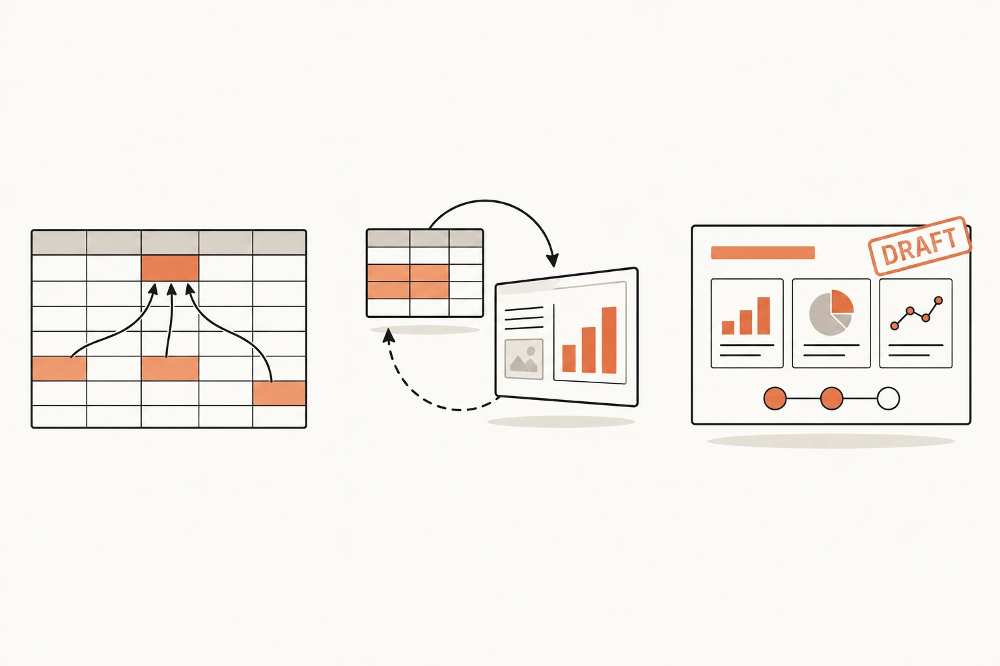
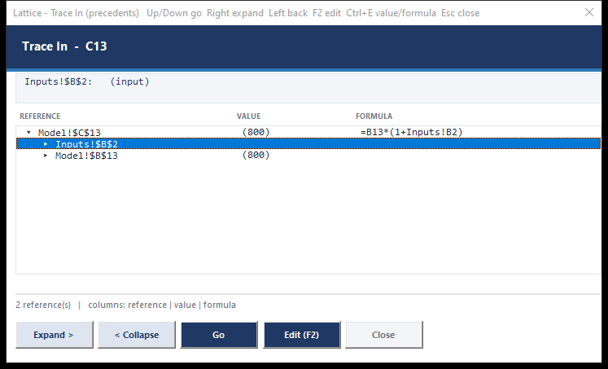
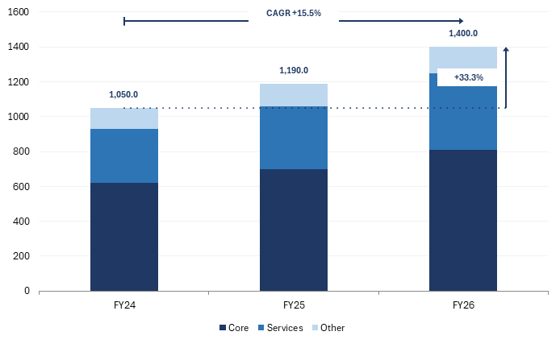
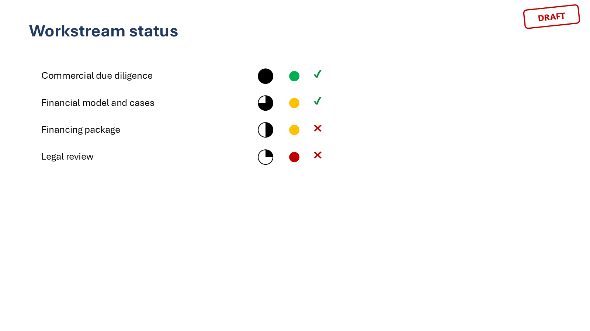
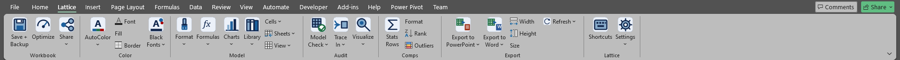

<p align="center"></p>

<p align="center"><b>The banker's toolkit for Excel, PowerPoint and Word. Open source, no subscription, no telemetry.</b></p>

<p align="center">
  <a href="docs/Lattice_Guide.pdf">Guide (PDF)</a> ·
  <a href="docs/Lattice_Manual.pdf">Shortcut manual (PDF)</a> ·
  <a href="docs/GUIDE.md#5-compared-with-macabacus-and-think-cell">Compared with Macabacus and think-cell</a> ·
  <a href="#install">Install</a>
</p>

---

Lattice puts the workflow of a Macabacus-style productivity suite back on your machine as three
small add-ins you can read, build and change yourself. Link an Excel range into a deck and refresh
it with one key. Audit a model without touching the mouse. Run every case and get the comparison
on a styled sheet. Annotate a chart the think-cell way on a native Excel chart. Stamp a deck DRAFT
in one click.

It is a clean-room implementation: original VBA and a PowerShell build, no third-party code or
branding, and nothing leaves your computer.

<p align="center"></p>

## What you get

**Excel to PowerPoint and Word, linked.** Export a range, table, chart or text string into a slide
or a document with fonts forced black and the original colours left untouched in the model.
Refresh a shape, a slide or the whole deck; the picture keeps its place, size, name and z-order.
Links survive moved rows, renamed files and a closed workbook, and a version-aware prompt repoints
a deck from `Model_v1` to `Model_v2` in one go.

**Keyboard-only auditing.** `Ctrl+[` and `Ctrl+]` jump to precedents and dependents,
`Ctrl+Shift+Enter` walks back along the trail, and the Trace In / Trace Out window shows the whole
reference tree with values and formulas while the arrow keys move Excel live. Enter jumps and
closes so F2 works at once. Jumps always scroll the cell into view, frozen panes included.

<p align="center"></p>

**Model Check.** One list of every hard-code, masked error, inconsistent formula and unused input
in a sheet or a workbook. Double-click to jump, one button to move a literal into an input cell,
one to write a styled report sheet.

**Case runner.** Point at the case switch and the outputs you care about; Lattice runs every case,
restores the switch and writes a comparison sheet with the change against base, number formats
preserved, data bars included.

**Charts that explain themselves.** Total labels above stacks that stay live, CAGR arrows across
categories and difference arrows between two of them, drawn inside a native Excel chart so they
travel into PowerPoint through the picture link. Plus football field, stacked-with-totals and
waterfall builders.

<p align="center"></p>

**Formatting at the speed of thought.** Number, percent, multiple, date and currency cycles, font
and fill cycles, AutoColor for inputs / formulas / links / external links, a Black Fonts switch for
presenting straight from the sheet, and a shortcut file you can edit in Notepad.

**A model library.** DCF, Black-Scholes, returns, debt schedule, sensitivity table, quick LBO with
sources and uses and exit returns, distribution waterfall, accretion / dilution, credit statistics,
scenario block, timeline header, plus your own personal library workbook.

**PowerPoint, the think-cell parts.** Auto-align and arrange shapes, containers and stacks, turbo
shapes (Harvey balls, traffic lights, chevrons), master shapes, global styles, agenda and section
dividers that stay in sync, pagination and table-of-contents, deck check, a font harmoniser, and
stickers: traffic lights, ticks and crosses, and DRAFT / CONFIDENTIAL / PRELIMINARY stamps.

<p align="center"></p>

**Word too.** The same import and refresh engine for documents, with a link list, go-to-source and
break-link tools.

## Install

Windows with the Microsoft 365 desktop apps (where it is tested), per user, no admin rights.

1. Close Excel, PowerPoint and Word.
2. Run the installer:

```powershell
powershell -ExecutionPolicy Bypass -File "build\install.ps1"
```

3. Open any of the three applications and look for the **Lattice** tab. Keytips: `Alt, K` in
   Excel, `Alt, L` in PowerPoint and Word. `-Uninstall` removes everything again.

The installer copies the three add-ins from `dist\` into your per-user add-in folders and registers
them the way Office expects. Nothing outside your user profile changes.

<p align="center"></p>

## Learn it in an evening

- [docs/Lattice_Guide.pdf](docs/Lattice_Guide.pdf): an eight-page guide to what Lattice does,
  what it deliberately does not do, and how it compares with Macabacus and think-cell.
- [docs/Lattice_Manual.pdf](docs/Lattice_Manual.pdf): every shortcut and keytip on four pages.
- [docs/GUIDE.md](docs/GUIDE.md): the same guide as text, including how the build works.
- [docs/examples](docs/examples): a frozen-panes workbook to try the navigation tools on.

Settings live in a single dialog (Lattice > Settings) and in two plain-text files under
`%APPDATA%\Lattice`: the shortcut map and the style guide. Both are created with defaults on first
use and reload when you save them.

## What it is not

Lattice does not ship a 3,000-item chart library, a cloud sync or a licence server. It does not
hook the keyboard in PowerPoint (VBA cannot do that safely), so PowerPoint tools run from keytips or
the Quick Access Toolbar. It is built for the people who used Macabacus mostly for linking,
auditing and formatting, and who would rather own the code than rent it.

## Build from source

Everything is plain VBA under `src\` and a PowerShell build. The build lints the modules, imports
them through the VBE, compiles each project, saves the add-ins and injects the ribbon XML with the
same packaging API Office uses.

```powershell
powershell -ExecutionPolicy Bypass -File "build\build.ps1"
```

Close Office first. `tests\` holds COM-driven regression scripts for every tool (run them one at a
time, with Office closed), plus `tests\privacy_scan.ps1`, which fails if anything personal ever
reaches the tracked files. See [docs/GUIDE.md](docs/GUIDE.md#6-how-it-is-built) for the design
decisions behind the build.

```
src\shared     settings, Excel instance handling, black-font picture copy
src\excel      formatting, modelling, auditing, library, charts, export, keys, ribbon
src\ppt        links, text links, shapes, styles, deck tools, turbo shapes, stickers, ribbon
src\word       import, refresh, ribbon
ribbon\        customUI14 definitions and the icon set
build\         build, install, icons, settings forms, guide and manual generators
tests\         regression scripts and screenshot capture
```

## Credits and licence

Built by Chiltern Capital Management. Lattice reproduces workflows, not code: Macabacus and
think-cell are trademarks of their owners and nothing of theirs is included. Licence: see
[docs/GUIDE.md](docs/GUIDE.md#8-licence) (to be set before the first public release).
